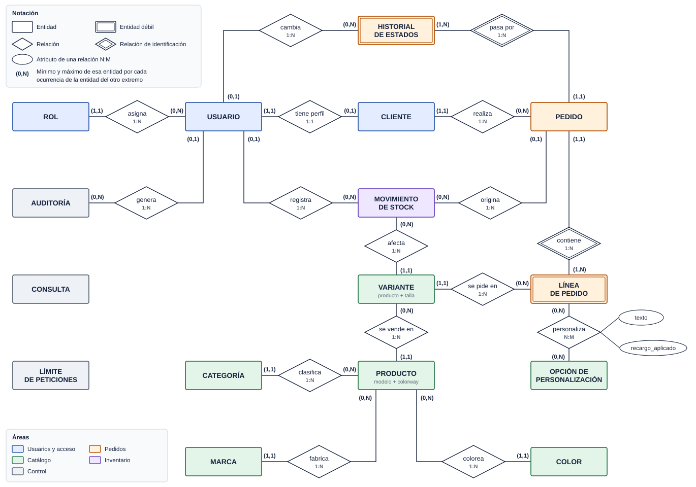
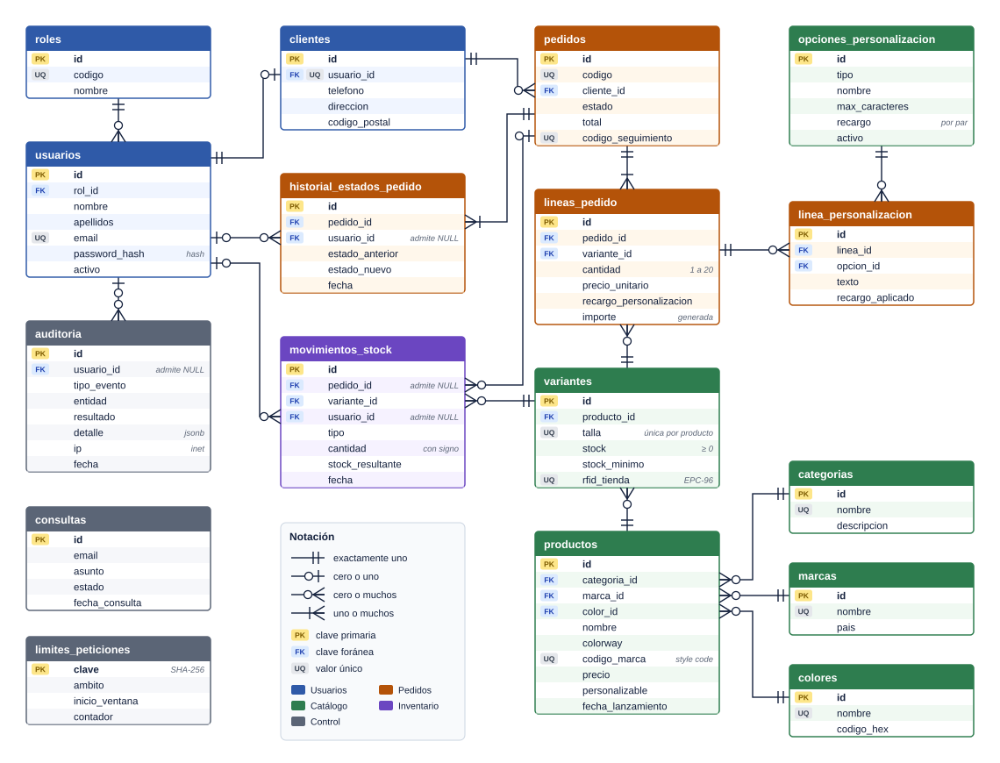

# Diagrama entidad/relación · KALMA SNKRS

Modelo de datos de [`database/schema.sql`](../database/schema.sql): PostgreSQL 17 con 17 tablas.
Se presenta en dos niveles: el modelo conceptual (qué cosas existen y cómo se relacionan) y el
esquema relacional (cómo quedan las tablas, sus claves y sus restricciones).

## 1. Modelo conceptual

Notación de Chen con cardinalidades mínimas y máximas. La pareja que hay junto a cada entidad indica
cuántas ocurrencias de esa entidad se relacionan con **una** ocurrencia de la entidad del otro extremo.
Por ejemplo, en `CLIENTE —realiza— PEDIDO`, el `(1,1)` junto a CLIENTE dice que cada pedido es de un
solo cliente, y el `(0,N)` junto a PEDIDO dice que un cliente puede tener ninguno o muchos pedidos.

- **Entidades débiles** (doble borde): LÍNEA DE PEDIDO e HISTORIAL DE ESTADOS no existen sin su pedido
  y se borran con él (`ON DELETE CASCADE`). Su relación con PEDIDO es de identificación (rombo doble).
- **Relación N:M con atributos**: una línea de pedido puede llevar varias opciones de personalización y
  una opción se elige en muchas líneas. La relación guarda el texto bordado y el recargo aplicado.
- **CONSULTA** y **LÍMITE DE PETICIONES** no se relacionan con nada: la consulta la puede enviar un
  visitante sin cuenta y los límites guardan hashes, no referencias.

## 2. Esquema relacional

Notación de pata de gallo. Se muestran las claves y las columnas que explican cada tabla; las fechas
de alta y actualización, los textos descriptivos y los tipos exactos están en `database/schema.sql`.
`talla` es única dentro de su producto y `codigo_marca` dentro de su marca (restricciones `UNIQUE` compuestas).

### Del modelo conceptual a las tablas

| En el modelo conceptual | En el esquema relacional |
|---|---|
| Relación 1:N (por ejemplo, CLIENTE realiza PEDIDO) | Clave foránea en la tabla del lado N (`pedidos.cliente_id`) |
| Relación 1:1 USUARIO tiene perfil CLIENTE | Clave foránea con `UNIQUE` en `clientes.usuario_id` |
| Cardinalidad mínima 0 en el lado 1 (registra, origina, cambia, genera) | Clave foránea que admite `NULL` y `ON DELETE SET NULL` |
| Entidad débil (LÍNEA DE PEDIDO, HISTORIAL DE ESTADOS) | Clave foránea `NOT NULL` con `ON DELETE CASCADE` hacia `pedidos` |
| Relación N:M personaliza, con atributos | Tabla `linea_personalizacion` con dos claves foráneas, `UNIQUE (linea_id, opcion_id)`, `texto` y `recargo_aplicado` |
| Cardinalidad mínima 1 en PEDIDO contiene LÍNEA | No se puede expresar con una restricción de tabla: la exige el servicio al crear el pedido |

## 3. Relaciones

| Origen → destino | Cardinalidad | FK | ON DELETE |
|---|---|---|---|
| usuarios → roles | N : 1 | `usuarios.rol_id` | NO ACTION (impide borrar) |
| clientes → usuarios | 0..1 : 1 | `clientes.usuario_id` (UNIQUE) | CASCADE |
| pedidos → clientes | N : 1 | `pedidos.cliente_id` | NO ACTION |
| productos → categorias | N : 1 | `productos.categoria_id` | NO ACTION |
| productos → marcas | N : 1 | `productos.marca_id` | NO ACTION |
| productos → colores | N : 1 | `productos.color_id` | NO ACTION |
| variantes → productos | N : 1 | `variantes.producto_id` | NO ACTION |
| lineas_pedido → pedidos | N : 1 (el servicio exige al menos 1 línea) | `lineas_pedido.pedido_id` | CASCADE |
| lineas_pedido → variantes | N : 1 | `lineas_pedido.variante_id` | NO ACTION |
| linea_personalizacion → lineas_pedido | N : 1 | `linea_personalizacion.linea_id` | CASCADE |
| linea_personalizacion → opciones_personalizacion | N : 1 | `linea_personalizacion.opcion_id` | NO ACTION |
| historial_estados_pedido → pedidos | N : 1 | `historial_estados_pedido.pedido_id` | CASCADE |
| historial_estados_pedido → usuarios | N : 0..1 | `historial_estados_pedido.usuario_id` | SET NULL |
| movimientos_stock → variantes | N : 1 | `movimientos_stock.variante_id` | NO ACTION |
| movimientos_stock → pedidos | N : 0..1 | `movimientos_stock.pedido_id` | SET NULL |
| movimientos_stock → usuarios | N : 0..1 | `movimientos_stock.usuario_id` | SET NULL |
| auditoria → usuarios | N : 0..1 | `auditoria.usuario_id` | SET NULL |

`consultas` no tiene relaciones: la puede enviar un visitante anónimo. `limites_peticiones` tampoco: sus claves son hashes, no referencias a otras tablas.

## 4. Justificación de las tablas

**Usuarios y acceso**
- **roles**: los perfiles (admin, almacen, cliente) están en una tabla con FK en lugar de un CHECK, así que añadir un rol no obliga a cambiar el esquema. La matriz de permisos está en el middleware PHP.
- **usuarios**: datos de acceso comunes a clientes y personal. Solo guarda el hash de la contraseña, y el email es único sin distinguir mayúsculas.
- **clientes**: perfil 1:1 separado del acceso. Solo los clientes tienen teléfono y dirección de envío, así el personal interno no deja columnas vacías. KALMA vende a particulares por internet: no hay tipos de cliente ni se pide el DNI (minimización de datos personales).

**Catálogo**
- **categorias**: agrupa el catálogo (Lifestyle, Air Max, Jordan) para poder filtrar.
- **marcas**: evita repetir la marca en cada producto y permite que el código de estilo sea único por marca.
- **colores**: color principal normalizado (nombre y hex) para el filtro por color.
- **productos**: un modelo en una combinación de colores, como en Nike.com, con su código de estilo real, su precio, su foto y si admite bordado (`personalizable`).
- **variantes**: producto + talla. Es lo que se vende y lo que tiene stock. Su `CHECK (stock >= 0)` es la última defensa contra la sobreventa. Aquí va también la etiqueta RFID de la tienda.
- **opciones_personalizacion**: catálogo de personalizaciones de un producto exclusivo (caja, bordado del nombre, cordones de repuesto y certificado de autenticidad) con su recargo por par. `afecta_zapatilla` marca las que modifican la zapatilla, que solo se permiten en productos personalizables, y `max_caracteres` dice si la opción lleva texto y hasta qué longitud. El servidor valida contra esta tabla.

**Pedidos**
- **pedidos**: cabecera del pedido: cliente, estado (con CHECK), total y una copia de la dirección de envío del momento de la compra.
- **lineas_pedido**: detalle del pedido con una copia del nombre, la talla, el color y el precio aplicado. El importe es una columna generada y la misma variante no se repite dentro de un pedido.
- **linea_personalizacion**: opciones elegidas en cada línea, con el texto (el nombre bordado) y el recargo que se aplicó, para que el pedido no cambie si cambia el catálogo de opciones.
- **historial_estados_pedido**: guarda cada transición de estado (estado anterior y nuevo, quién y cuándo), tal como pide el enunciado.
- **movimientos_stock**: guarda cada cambio de stock (entrada, venta, cancelación, ajuste) con el stock resultante, para poder reconstruir y auditar el inventario.

**Control**
- **auditoria**: eventos de negocio con usuario, fecha, tipo, entidad y resultado. El detalle es JSONB y nunca guarda contraseñas ni tokens.
- **consultas**: formulario de contacto público. No tiene FK porque lo puede enviar un visitante anónimo.
- **limites_peticiones**: contadores del rate limiting (ej. 5 intentos de login por cuenta cada 15 minutos). Vive en la BD para que el límite lo compartan todos los procesos de Apache y no se pueda esquivar borrando cookies. Guarda hashes en vez de IPs o emails en claro.

## 5. Códigos de producto: `codigo_marca` no es `rfid_tienda`

| | `productos.codigo_marca` | `variantes.rfid_tienda` |
|---|---|---|
| Qué es | Código de estilo (*style code*) de Nike | Etiqueta RFID (EPC-96) de KALMA |
| Ejemplo | `CW2288-111` = modelo `CW2288` + color `111` | `4B4C4D…` (24 caracteres hex) |
| Nivel | Modelo + color (el mismo en todas las tallas) | Cada talla |
| Origen | Real, impreso en la caja y en la lengüeta | Lo genera la tienda |
| Unicidad | `UNIQUE (marca_id, codigo_marca)` | `UNIQUE` en toda la tabla |

`codigo_marca` **no es un RFID**: un EPC identifica tallas o unidades, y la marca no lo publica.
